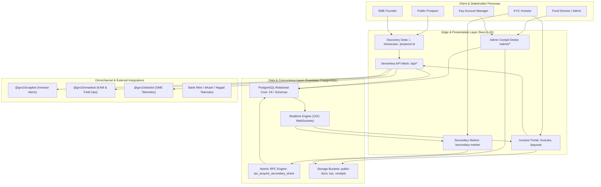

# GRO10X CAPITAL OS — SYSTEM ARCHITECTURE & ENTERPRISE SCALABILITY AUDIT
**Document Version:** 2.0.0-ENTERPRISE  
**Date:** October 2026  
**Auditor:** Principal System Architect & Platform Director  
**Environment:** Production (`https://capital.gro10x.com`) | Local (`http://localhost:3000`) | Database: Supabase PostgreSQL (Managed)  
**Governance Scope:** All Routes (`src/app`), Serverless APIs (`src/app/api`), Schemas & Migrations (`supabase_*.sql`), QA Registry (`extension/suites/registry.js`).

---

## 1. Executive Summary & Architectural Assessment

GRO10X CAPITAL OS is an enterprise-grade private alternative investment and syndication operating system for Bangladesh and frontier markets. It coordinates **7 core stakeholder personas** (Investors, Founders, Promoters, KAMs, Admin/Fund Directors, Corporate Buyers, Field Staff) across an SPV-backed equity & revenue-share model.

### Key Architectural Findings:
1. **Frontend-to-Backend Asymmetry:** The platform contains 34 page routes and 24 API routes. While core capital flows (Discovery, Bookings, Investor Dashboard, Secondary Market, POS Sync, and Work Orders) are wired to live Supabase tables, several legacy routes (`/funding-rounds`, `/ai-assistant`, `/fraud-detection`) rely on hardcoded mock fallbacks or client-side heuristic engines.
2. **Admin Portal Sprawl:** `src/app/admin/page.js` is a **3,298-line monolith** managing **15 operational tabs**, **4 slide-over inspection drawers**, and **over 35 state variables**. While tabs have been extracted into individual components (`src/app/admin/tabs/*`), the parent file still executes a massive, non-paginated waterfall fetch across 18 distinct database tables on initial mount (`fetchAdminData`), generating significant client memory bloat and connection thrashing.
3. **Database Concurrency & Transaction Integrity Risks:** High-value capital operations (e.g., Secondary share transfers in `handleClearSecondaryOrder` and Secondary acquisition locks in `secondary-market/page.js`) execute as chained client-side Supabase `update` calls rather than atomic PostgreSQL RPC transactions (`SERIALIZABLE` isolation / database functions with row-level locks). Under concurrent traffic, this poses severe double-allocation and ledger desynchronization risks.
4. **Missing Composite Database Indexes:** Relational queries filter and join heavily across `funding_projects`, `investments`, `secondary_orders`, and `pos_daily_sales` on foreign keys and compound status/created_at columns without composite indexes, risking full table scans as rows scale beyond 10k records.

---

## 2. Feature Inventory Matrix (Built vs. Unbuilt)

### Status Definitions:
- `[PRODUCTION LIVE]`: End-to-end connected to live Supabase DB with real data mutation and error handling.
- `[MOCK / HARDCODED]`: UI functions using static arrays, simulated delays, or hardcoded mock constants.
- `[ORPHANED UI]`: Present in DOM/routing but lacks navigation ingress, user action persistence, or functional state sync.
- `[DATABASE DEBT]`: Feature exists and writes to DB, but relies on unindexed queries, non-atomic multi-step client mutations, or unvalidated types (e.g. UUID casting risks).

| Route / Subsystem | Primary Persona | Status | Backing Data Source / Table | Architectural Assessment & Technical Gaps |
| :--- | :--- | :--- | :--- | :--- |
| **`/` (Homepage)** | Public / Prospect | `[PRODUCTION LIVE]` | `funding_projects`, `businesses` | Live metric rollups, referral capture (`?ref=CODE`), and ROI calculator. Fully wired. |
| **`/showcase`** | Public / Prospect | `[PRODUCTION LIVE]` | `funding_projects`, `businesses` | Live deal catalog with sector filters, search, and dynamic yield badge formatting. |
| **`/projects/[id]`** | Prospect / Investor | `[PRODUCTION LIVE]` | `funding_projects`, `businesses`, `project_media`, `investment_bookings` | Full deal room with dynamic return calculators, LeadBot drawer, and allocation booking. |
| **`/funding-rounds`** | Founder / Investor | `[MOCK / HARDCODED]` | Static `rounds` array | Hardcoded 3-round array (`ORO Roasters`, `Segreto`). Form simulates submission without persisting to `funding_projects`. Needs live Supabase sync. |
| **`/investor`** | Verified Investor | `[PRODUCTION LIVE]` | `investors`, `investments`, `investor_yields`, `kyc_submissions` | 4-Card KPI telemetry, Recharts yield charts, document vault, and 3-tier KYC stepper. |
| **`/investor-onboard`**| Investor | `[PRODUCTION LIVE]` | `telegram_auth_pins`, `investors` | Web PIN verification, phone linking, and Telegram bot onboarding. |
| **`/payouts`** | Investor / Promoter | `[DATABASE DEBT]` | `payout_requests`, `promoters` | Only wires promoter referral commissions. Does not provide self-service dividend cashout for investors. |
| **`/secondary-market`**| L2 KYC Investor | `[DATABASE DEBT]` | `secondary_orders`, `investments` | Live orderbook & Realtime subscription. However, acquisition lock relies on client-side check-and-insert; prone to race conditions without Postgres RPC lock. |
| **`/cash-concierge`** | L3 VIP Investor | `[PRODUCTION LIVE]` | `cash_tickets`, `investors` | KYC Level 3 lockout guard, ticket submission, and KAM assignment. |
| **`/admin` (Master Hub)**| Fund Director | `[DATABASE DEBT]` | 18+ Supabase tables | 3,298-line monolith; massive waterfall fetch on mount; no virtualization or pagination on tables. |
| **`/business`** | SME Founder | `[PRODUCTION LIVE]` | `businesses`, `funding_projects`, `pos_daily_sales` | Cap table review, campaign progress, and daily sales logging. |
| **`/apply` & `/apply/status`**| SME Founder | `[PRODUCTION LIVE]` | `business_cohort_applications`, `business_stakeholders` | Multi-step 6-part fundraising application with document uploads and reference tracking. |
| **`/kam-dashboard`** | KAM / Field Ops | `[PRODUCTION LIVE]` | `cash_tickets`, `investors`, `business_audits`, `pos_daily_sales` | Assigned investor CRM, audit logs, and OTC ticket clearing. |
| **`/promoter`** | Growth Promoter | `[PRODUCTION LIVE]` | `team`, `promoter_leads`, `promoter_commissions`, `payout_requests` | Referral links, lead pipeline tracking, gamified targets, and commission logs. |
| **`/track/maats-cottage/*`**| Fund Director / Ops | `[PRODUCTION LIVE]` | `work_orders`, LocalStorage cache | Full 5-subroute work-order financing ledger with multi-tranche disbursements and PO inspector. |
| **`/ai-assistant`** | Prospect / Investor | `[MOCK / HARDCODED]` | Static regex matching | In-memory rule parser responding to keyword triggers. No LLM backend or vector search. |
| **`/fraud-detection`**| KAM / Admin | `[MOCK / HARDCODED]` | `pos_daily_sales` + static fallbacks | Queries `pos_daily_sales` but falls back to static `ALT-901..903` if no sales exist. Client-side anomaly detection. |
| **`/financial-model`**| Admin / Diligence | `[MOCK / HARDCODED]` | Client-side DCF state | Interactive DCF modeler, but inputs are purely client-side state without persistence to deal dossier. |
| **`/pos-sync`** | Outlet Staff / KAM | `[PRODUCTION LIVE]` | `pos_daily_sales`, `businesses` | Form for manual/CSV daily sales and expense entry with instant net margin computation. |
| **`/team-miniapp`** | All Internal Roles | `[PRODUCTION LIVE]` | Telegram WebApp SDK + Supabase | Role-adaptive mobile cockpit for Admin, KAM, Promoter, Investor, and Founder personas. |
| **`/telegram`** | Public / Internal | `[PRODUCTION LIVE]` | Static interactive preview | Interactive Telegram bot simulator and documentation guide for `@gro10xcapbot` and `@gro10xmanbot`. |
| **`/legal-contracts`**| Investor / Legal | `[DATABASE DEBT]` | Client templates | Renders SPV Share Certificates and Master Agreements, but lacks automated cryptographic hash stamping and live DB linkage. |

---

## 3. Scalability Risk Register & Technical Hardening Plan

### Top 5 Architectural Failure Points Under High Concurrent Traffic (10,000+ Active Investors/Day):

```
┌────────────────────────────────────────────────────────────────────────────────────────┐
│                                CONCURRENCY & BOTTLENECK AUDIT                          │
├──────────────────────────┬─────────────────────────────────┬───────────────────────────┤
│ Bottleneck               │ Failure Mode                    │ Target Architecture       │
├──────────────────────────┼─────────────────────────────────┼───────────────────────────┤
│ 1. Client Multi-Step     │ Double-allocation / race        │ Atomic PostgreSQL RPC     │
│    Secondary Settlement  │ conditions on share buyouts     │ with row-level locks      │
├──────────────────────────┼─────────────────────────────────┼───────────────────────────┤
│ 2. Admin Monolith        │ Browser UI freeze, excessive    │ Domain routes + cached    │
│    Initial Waterfall     │ DB egress, connection starvation│ React Query / SWR         │
├──────────────────────────┼─────────────────────────────────┼───────────────────────────┤
│ 3. Unindexed Foreign Key │ Full table scans as tables      │ Composite B-Tree indexes  │
│    & Status Joins        │ grow past 10,000 records        │ on hot query paths        │
├──────────────────────────┼─────────────────────────────────┼───────────────────────────┤
│ 4. Unbounded Supabase    │ Realtime WebSocket exhaustion   │ Channel multiplexing &    │
│    Realtime Subscriptions│ and battery drain               │ targeted row filters      │
├──────────────────────────┼─────────────────────────────────┼───────────────────────────┤
│ 5. Synchronous Blocking  │ API timeouts, webhook latency,  │ Asynchronous DB queue +   │
│    External Dispatches   │ Telegram rate limit (30 req/s)  │ background Edge Functions │
└──────────────────────────┴─────────────────────────────────┴───────────────────────────┘
```

### Deep Dive & Mitigations:

#### Risk 1: Race Conditions in Secondary Share Acquisition & Clearance
- **Root Cause:** In `src/app/secondary-market/page.js` (`handleAcquireListing`) and `src/app/admin/page.js` (`handleClearSecondaryOrder`), share purchases are performed as sequential client-side queries:
  1. Create booking in `investment_bookings`.
  2. Update `secondary_orders` where `status = 'Active'`.
  3. Transfer ownership in `investments` table (`update investor_id = buyerId`).
- **Failure Mode:** Two concurrent buyers clicking "Acquire" within milliseconds can both generate bookings. If an admin clears or an edge condition intervenes, the share record or ledger ownership gets orphaned or corrupt.
- **Architectural Mitigation:**
  Create an atomic PostgreSQL RPC function executed with `SERIALIZABLE` or `FOR UPDATE` row lock:
  ```sql
  CREATE OR REPLACE FUNCTION rpc_acquire_secondary_share(
      p_order_id UUID,
      p_buyer_investor_id UUID
  ) RETURNS JSONB AS $$
  DECLARE
      v_order RECORD;
      v_booking_id UUID;
  BEGIN
      -- Acquire explicit row lock
      SELECT * INTO v_order FROM public.secondary_orders 
      WHERE id = p_order_id AND status = 'Active' FOR UPDATE;
      
      IF NOT FOUND THEN
          RAISE EXCEPTION 'Order is no longer available or already locked.';
      END IF;

      -- Create booking atomically
      INSERT INTO public.investment_bookings (
          investor_id, project_id, amount_bdt, yield_option, booking_type, status
      ) VALUES (
          p_buyer_investor_id, 
          (SELECT funding_project_id FROM public.investments WHERE id = v_order.investment_id),
          v_order.seller_price_bdt, 1, 'Secondary', 'Pending_Proof'
      ) RETURNING id INTO v_booking_id;

      -- Lock order to Pending_Clearance
      UPDATE public.secondary_orders 
      SET status = 'Pending_Clearance', buyer_booking_id = v_booking_id, updated_at = NOW()
      WHERE id = p_order_id;

      RETURN jsonb_build_object('success', true, 'booking_id', v_booking_id);
  END;
  $$ LANGUAGE plpgsql SECURITY DEFINER;
  ```

#### Risk 2: Admin Monolith Waterfall Load & State Bloat
- **Root Cause:** `src/app/admin/page.js` loads data from 18 distinct tables in one unpaginated `fetchAdminData()` call. As `investors`, `pos_daily_sales`, `notifications`, and `promoter_leads` scale into thousands of records, downloading full tables into browser RAM triggers severe memory consumption, slow first-contentful-paint, and database connection timeouts.
- **Architectural Mitigation:**
  - Transition from monolithic single-page tab swapping to domain-driven sub-routes (`/admin/deals`, `/admin/investors`, `/admin/yield`, `/admin/compliance`, `/admin/ops`).
  - Introduce server-side pagination (`.range(from, to)`) with default page sizes of 25 records.
  - Implement SWR / React Query caching with stale-while-revalidate so tab switching is instantaneous and only fetches data relevant to that operational domain.

#### Risk 3: Missing Composite Database Indexes
- **Root Cause:** Existing migrations created only 5 foreign key indexes. High-frequency queries in `fetchAdminData`, `/investor`, and `/secondary-market` perform multi-column filters without compound indexes:
  - `funding_projects` filtered on `(status, show_on_showcase)`
  - `investment_bookings` filtered on `(investor_id, status)`
  - `secondary_orders` filtered on `(status, created_at)`
  - `investor_yields` filtered on `(investor_id, disbursement_id)`
  - `pos_daily_sales` filtered on `(business_id, date)`
- **Architectural Mitigation:** Apply compound indexes:
  ```sql
  CREATE INDEX IF NOT EXISTS idx_funding_projects_status_show ON public.funding_projects(status, show_on_showcase);
  CREATE INDEX IF NOT EXISTS idx_invest_bookings_inv_status ON public.investment_bookings(investor_id, status);
  CREATE INDEX IF NOT EXISTS idx_secondary_orders_status_date ON public.secondary_orders(status, created_at DESC);
  CREATE INDEX IF NOT EXISTS idx_investor_yields_inv ON public.investor_yields(investor_id, created_at DESC);
  CREATE INDEX IF NOT EXISTS idx_pos_sales_biz_date ON public.pos_daily_sales(business_id, date DESC);
  CREATE INDEX IF NOT EXISTS idx_cash_tickets_status ON public.cash_tickets(status, created_at DESC);
  ```

#### Risk 4: Unbounded Supabase Realtime Channels
- **Root Cause:** Both the secondary marketplace and investor portals establish table-wide subscriptions without tenant or status filters.
- **Architectural Mitigation:** Narrow subscription channels using Postgres filter predicates:
  - `table: 'secondary_orders', filter: 'status=eq.Active'`
  - `table: 'investment_bookings', filter: 'investor_id=eq.' + userInvestorId`

#### Risk 5: Synchronous Telegram Bot & External Webhook Delays
- **Root Cause:** User-facing requests (e.g. ticket submission in `/cash-concierge` or secondary order acquisition) trigger direct, synchronous `fetch('/api/telegram-*')` calls. If Telegram's API throttles or responds in >2 seconds, the client UI hangs or fails to complete state transitions.
- **Architectural Mitigation:**
  - Decouple notifications via an asynchronous `notification_queue` table or non-blocking event dispatch.
  - Wrap Telegram dispatches in background retry logic with circuit breaking (exponential backoff on HTTP 429).

---

## 4. Admin Portal Decomposition Blueprint

### Current Monolith State (`src/app/admin/page.js`):
- **3,298 Lines of Code**
- **15 Integrated Tabs**
- **4 Large Modals/Drawers**
- **45+ State Variables**
- **All Data Fetched on Root Load**

### Target Modular Architecture: Operational Cockpit Hub

Instead of a monolithic page, we deconstruct the Admin Portal into clean, role-tailored sub-routes and domain contexts:

```
src/app/admin/
├── layout.js                     <-- Global Admin Shell, Header, Role Guard & Collapsible Sidebar
├── page.js                       <-- Lightweight Command Center (Executive KPI Rollups & Priority Feed)
├── deals/                        <-- Deal Pipeline, Origination Kanban, SPV Valuation Modeler
│   ├── page.js
│   └── [id]/page.js
├── registry/                     <-- Business Cohort Applications & SME Brand Registry
│   └── page.js
├── investors/                    <-- Investor Hub, 3-Tier KYC Review Queue, Payment Proof Audits
│   ├── page.js
│   └── [id]/page.js
├── capital/                      <-- Capital Desk: Yield Engine, Cash Concierge & Secondary Clearing
│   ├── yield/page.js
│   ├── concierge/page.js
│   └── secondary/page.js
├── work-orders/                  <-- Safe Plan Wealth Management & Corporate Work-Order Financing
│   └── page.js
├── team/                         <-- KAM Field Ops, Promoters CRM, Commission Payouts
│   └── page.js
└── platform/                     <-- Telegram Bot Configs, Platform Governance & Audit Logs
    └── page.js
```

### Progressive Disclosure & Minimal Cockpit UI Guidelines:
1. **Domain Isolation:** Each desk loads only its own data. Switching from Deals to KYC doesn't re-trigger a 18-table query.
2. **Context-Specific Action Drawers:** Drawers (`InvestorDetailDrawer`, `CohortInspectionDrawer`) are dynamically imported (`next/dynamic`) and opened on demand, reducing initial bundle size by ~40%.
3. **Unified Metric Cards:** Global headers display real-time counters (e.g., `Pending KYC: 4`, `Pending Proofs: 7`, `Pending Secondary: 2`) driven by efficient count queries (`.select('*', { count: 'exact', head: true })`).

---

## 5. System Architecture & Domain Data Flow



---

## 6. PM Domain Governance & API Contracts

As Principal System Architect, all upcoming PM initiatives must strictly adhere to these 4 architectural constraints:

1. **Schema Migrations:**
   - Every column addition or new table must be defined in an idempotent SQL migration file (`supabase_migration_vX.X.X.sql`) with explicit foreign key constraints, `ON DELETE` rules, and indexes.
   - Raw client mutations modifying multiple tables must be converted into PostgreSQL RPC functions to ensure ledger immutability.
2. **UUID Integrity Defense:**
   - All serverless endpoints and client fetchers must sanitize UUID parameters against `^[0-9a-fA-F-]{36}$` prior to invoking Supabase to eliminate Postgres `22P02` syntax errors.
3. **Shared API Contracts:**
   - All notification dispatches must route through standardized payload schemas matching `src/app/api/telegram-notify-*`.
4. **Automated QA Suite Compliance:**
   - No pull request or refactoring will be merged without 100% passing results across the 8-platform test registry in `extension/suites/registry.js`.

---

## 7. Recommended Milestone Execution Roadmap

| Milestone | Target Domain | Objectives | Estimated Effort |
| :--- | :--- | :--- | :--- |
| **Milestone 1** *(Current)* | **Platform Audit & Blueprint** | Full inventory audit, risk register, decomposition blueprint, and architectural approval. | Complete |
| **Milestone 2** | **Concurreny & Concurrency Hardening** | Implement PostgreSQL RPC functions for Secondary Share transactions, add compound indexes, and UUID sanitization. | Next Step |
| **Milestone 3** | **Admin Monolith Modularization** | Decouple `admin/page.js` into modular domain sub-routes or extracted controllers with paginated data fetching. | Subsequent |
| **Milestone 4** | **Debt Elimination & Feature Wiring** | Wire live Supabase queries to `/funding-rounds`, add Investor dividend cashout to `/payouts`, and calibrate QA test suites. | Final Hardening |
